# ChaiKit ☕

> **Add a beautiful "Buy Me a Chai" supporter widget to any website.**  
> An open-source, lightweight, customizable widget powered by direct UPI payments.

[](https://github.com/arun-codex/chaikit/actions/workflows/ci.yml)
[](https://github.com/arun-codex/chaikit/actions/workflows/deploy-pages.yml)
[](https://arun-codex.github.io/chaikit/)
[](LICENSE)

---

## 🌐 Live Interactive Playground

**Try the live configurator and widget on desktop or mobile:**  
👉 **[https://arun-codex.github.io/chaikit/](https://arun-codex.github.io/chaikit/)**

- **Live Preview:** Real `<chai-support>` web component running inside a realistic developer blog layout (*DevNotes*).
- **Responsive Viewports:** Instant switching between Desktop, Tablet, and Mobile preview frames.
- **Visual Configurator:** Customize creator name, UPI ID, themes, placements, custom tiers, and buttons in real time.
- **Safe Demo Mode:** Enabled by default on public showcases with non-payable QR placeholders and disabled payment app intents.
- **Code Generator:** 1-click customized code generation for Plain HTML (CDN), React / Next.js, Vue 3, and WordPress.

---

## 📸 Visual Showcase & Screenshot Gallery

| Desktop Showcase & Configurator | Support Modal with Live Steam |
| :---: | :---: |
| 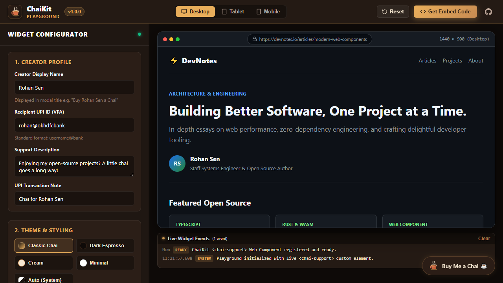 | 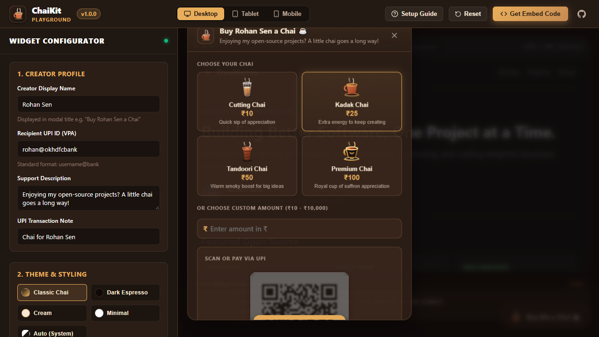 |

| Tier 1: Cutting Chai (₹10) | Tier 2: Kadak Chai (₹25) |
| :---: | :---: |
| 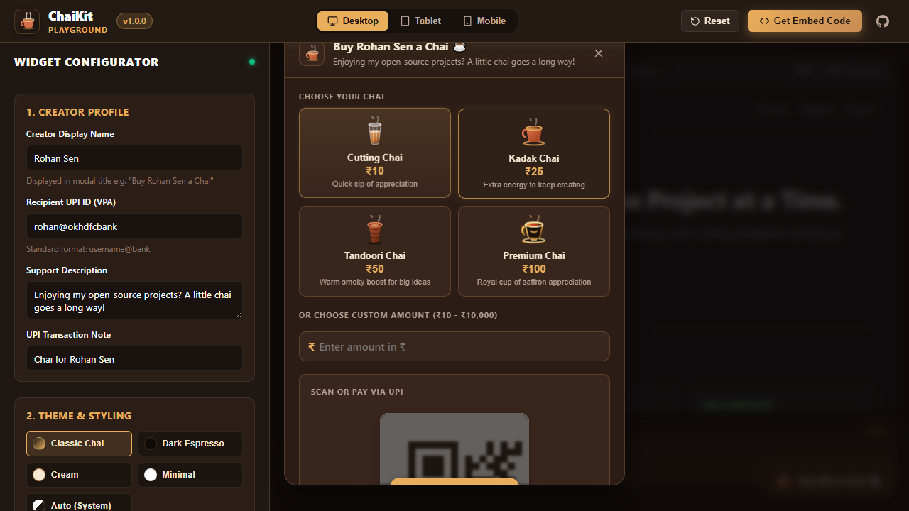 | 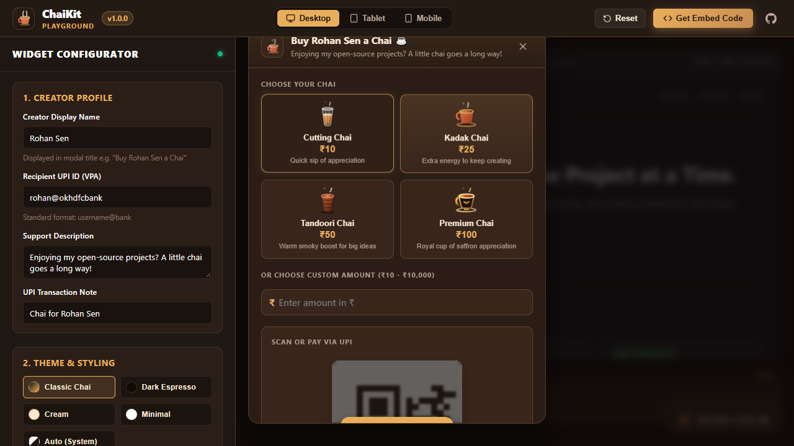 |

| Tier 3: Tandoori Kulhad (₹50) | Tier 4: Royal Premium Chai (₹100) |
| :---: | :---: |
| 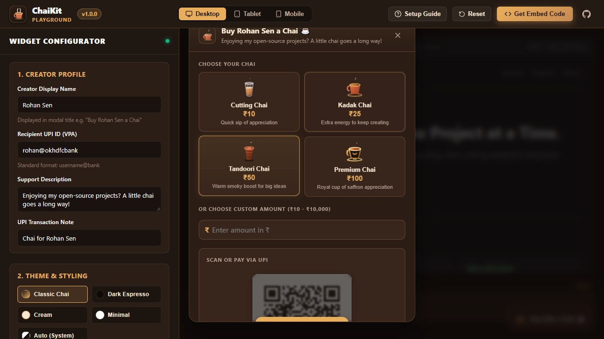 | 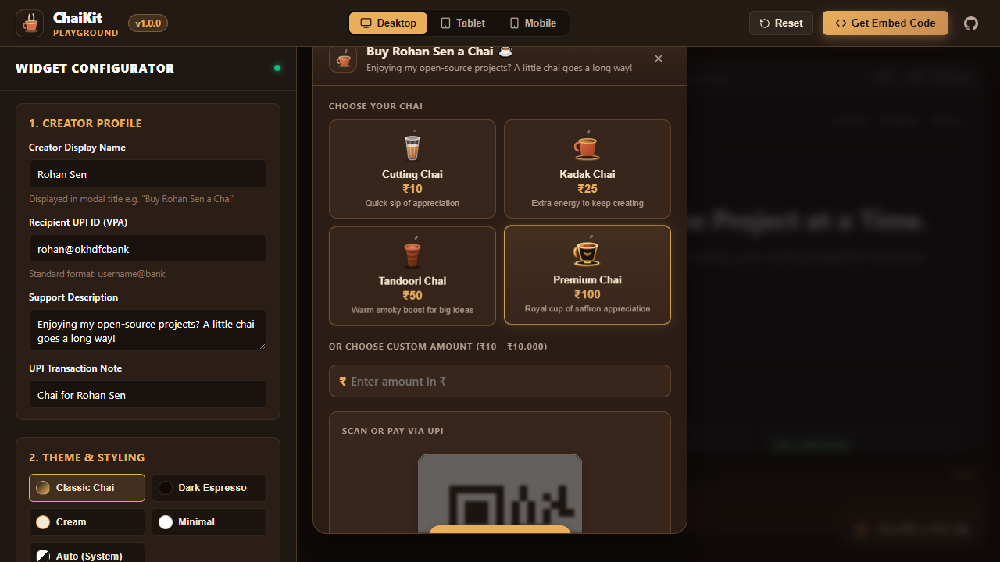 |

| Warm Cream Theme | Dark Roaster Theme |
| :---: | :---: |
| 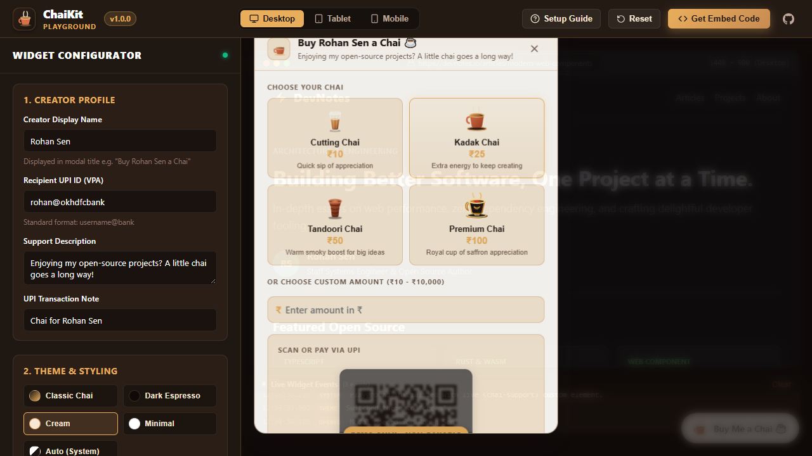 | 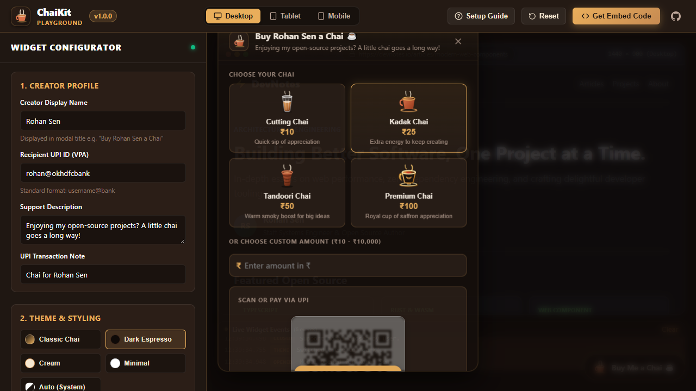 |

| Mobile Modal Responsive Layout | Safe Demo QR (Non-payable) |
| :---: | :---: |
| 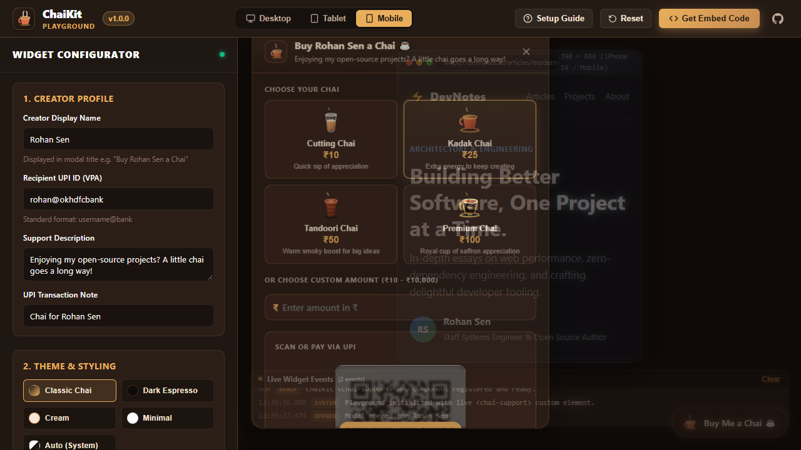 | 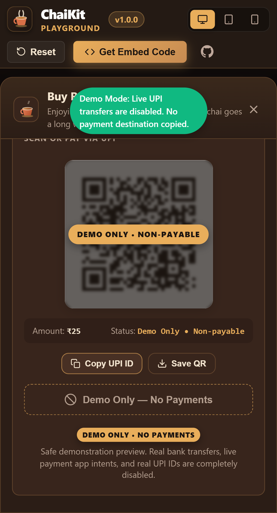 |

| Optional Procedural 3D Stage | Live Visual Configurator & Telemetry |
| :---: | :---: |
| 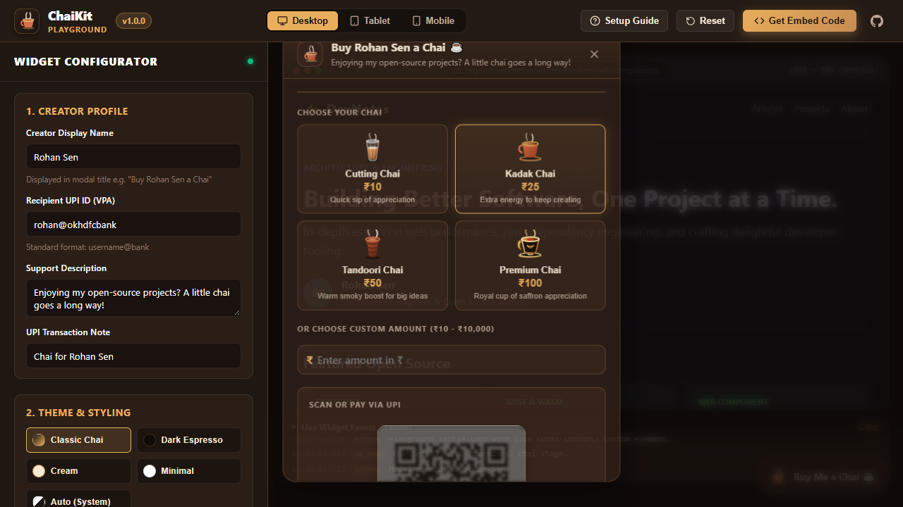 | 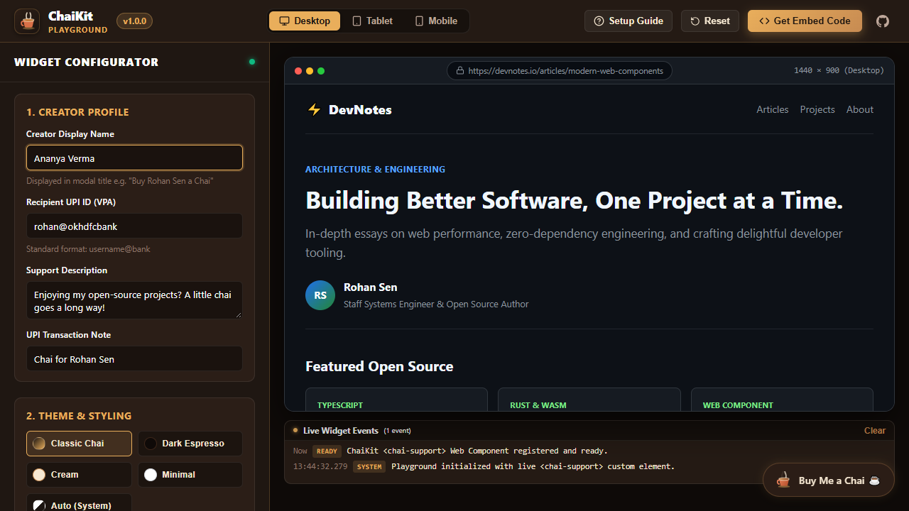 |

---

## Why ChaiKit?

Most creator support widgets are built for Western payment gateways or require creators and supporters to create accounts on third-party platforms that charge platform commissions.

**ChaiKit** is an independently engineered, universal JavaScript library that allows Indian creators, bloggers, and open-source developers to receive direct UPI contributions straight to their own bank account:

- **Universal:** Works in plain HTML, React, Next.js, Vue, Svelte, Astro, WordPress, Jekyll, Hugo, and static sites.
- **Zero Middlemen & Zero Fees:** 100% of contributions go directly to your configured UPI ID.
- **No Backend Required:** Self-contained client-side library. Runs on static websites and GitHub Pages.
- **Lightweight (~22 KB gzipped):** The entire standalone browser bundle — including all vector illustrations, steam animation physics, themes, and client-side QR engine — is **22.63 KB gzipped** (well below the 50 KB budget).
- **Optional 3D Visuals:** Procedural 3D clay kulhad mode (**3.93 KB gzipped**), lazy-loaded on demand with zero heavy external 3D engine dependencies.
- **Privacy-First:** Zero analytics, zero cookies, zero external network requests.
- **Accessible (WCAG 2.2 AA):** Fully keyboard navigable, modal focus-trapped, screen-reader friendly, and respects reduced-motion preferences.
- **Payment Truthful:** Never fakes transaction verification, receipts, or supporter counters.

---

## Install from the correct npm scope

The official packages in this repository are `@chaikit/core`, `@chaikit/widget`, and `@chaikit/react`.
The unscoped npm package named `chaikit` is **not** one of these packages. Verify
the exact `@chaikit/` scope and package provenance before installing dependencies.
A GitHub Actions release **dry run** checks packages but does not publish them to npm.

## Quick Start

### 1. Plain HTML / Static Sites / WordPress Embed

Add the script and custom element before your closing `</body>` tag:

```html
<!-- Load ChaiKit from CDN (pin the version in production) -->
<script defer src="https://cdn.jsdelivr.net/npm/@chaikit/widget@1.0.0/dist/chaikit.iife.js"></script>

<!-- Place the widget -->
<chai-support
  creator-name="Ananya Sharma"
  upi-id="ananya@okhdfcbank"
  theme="auto"
  position="bottom-right"
></chai-support>
```

### 2. npm / Bundler Installation

```bash
npm install @chaikit/widget
```

In your application entry file:

```ts
import '@chaikit/widget';
```

Then use `<chai-support>` in your HTML templates, Vue, Svelte, or JSX.

### 3. React / Next.js Integration

```bash
npm install @chaikit/react
```

```tsx
'use client';

import React from 'react';
import { ChaiSupport } from '@chaikit/react';

export function Header() {
  return (
    <ChaiSupport
      creatorName="Pooja Sharma"
      upiId="pooja@upi"
      description="Enjoying my work? A little chai goes a long way!"
      theme="classic"
      position="bottom-right"
      buttonText="Buy Me a Chai ☕"
      onTierSelected={(tier) => console.log('Selected:', tier.name)}
      onHandoffAttempt={(uri) => console.log('UPI intent:', uri)}
    />
  );
}
```

### 4. Vue 3 Integration

```bash
npm install @chaikit/widget
```

In your Single File Component (`.vue`):

```vue
<template>
  <chai-support
    creator-name="Aarav Mehta"
    upi-id="aarav@okhdfcbank"
    theme="auto"
    position="bottom-right"
    button-text="Buy Me a Chai ☕"
  />
</template>

<script setup>
import { onMounted } from 'vue';

onMounted(async () => {
  // Dynamically load the custom element in browser context
  await import('@chaikit/widget');
});
</script>
```

### 5. WordPress / Static CMS Sites

For WordPress, Ghost, Substack, Jekyll, or Hugo sites that permit custom HTML/scripts:

1. In WordPress Admin, navigate to **Appearance → Theme Settings → Custom Scripts** (or insert a **Custom HTML** block into your site footer or template).
2. Paste the single script tag and element:

```html
<!-- Load ChaiKit Web Component from CDN -->
<script defer src="https://cdn.jsdelivr.net/npm/@chaikit/widget@1.0.0/dist/chaikit.iife.js"></script>

<!-- Add the supporter widget -->
<chai-support
  creator-name="Rohan Sen"
  upi-id="rohan@okhdfcbank"
  theme="classic"
  position="bottom-right"
  button-text="Buy Me a Chai ☕">
</chai-support>
```

---

## Embedding Modes

### Mode A: Floating Widget (Default)
A subtle floating button appears in the corner with gentle steam animation:
```html
<chai-support creator-name="Dev" upi-id="dev@upi" position="bottom-right"></chai-support>
```

### Mode B: Inline Card
Embeds directly inside blog footers, author bios, or documentation:
```html
<chai-support creator-name="Dev" upi-id="dev@upi" position="inline"></chai-support>
```

### Mode C: Headless Trigger
Use your own custom button while ChaiKit manages the modal and UPI flow:
```html
<button onclick="document.getElementById('chai').open()">Support My Work ☕</button>
<chai-support id="chai" creator-name="Dev" upi-id="dev@upi" headless></chai-support>
```

---

## Contribution Tiers

| Tier | Name | Default Amount | Visual |
| :--- | :--- | :--- | :--- |
| 1 | **Cutting Chai** | ₹10 | Roadside fluted glass with rich tea foam |
| 2 | **Kadak Chai** | ₹25 | Classic spiced ceramic tea cup |
| 3 | **Tandoori Chai** | ₹50 | Rustic earthen clay kulhad |
| 4 | **Premium Chai** | ₹100 | Royal brass cup with saffron strands |

Supporters can also enter any custom amount between ₹10 and ₹10,000 (configurable).

---

## Configuration Reference

| Attribute | Type | Default | Description |
| :--- | :--- | :--- | :--- |
| `creator-name` | `string` | *(Required)* | Display name of the creator shown in modal and UPI payee name. |
| `upi-id` | `string` | *(Required)* | Payee Virtual Payment Address (e.g. `name@bank`). |
| `description` | `string` | `"Enjoying my work?..."` | Short message shown in header. |
| `button-text` | `string` | `"Buy Me a Chai ☕"` | Text on the floating launcher button. |
| `theme` | `'classic' \| 'dark' \| 'cream' \| 'minimal' \| 'auto'` | `'classic'` | Visual color theme. |
| `position` | `'bottom-right' \| 'bottom-left' \| 'inline'` | `'bottom-right'` | Placement on screen or inline flow. |
| `accent-color` | `string` | Theme default | Custom accent color override. |
| `enable-3d` | `boolean` | `false` | Enables optional 3D kulhad viewport. |
| `demo-mode` | `boolean` | `false` | Enables safe demonstration preview (non-payable QR, disabled intent). |
| `headless` | `boolean` | `false` | Suppresses floating button for custom triggers. |
| `min-amount` | `number` | `10` | Minimum custom contribution in ₹. |
| `max-amount` | `number` | `10000` | Maximum custom contribution in ₹. |

---

## Direct UPI Payments & Truthfulness Policy

A browser script cannot independently confirm whether an ordinary direct peer-to-peer (P2P) UPI payment succeeded. True verification requires a licensed payment aggregator backend and bank-authenticated webhooks.

ChaiKit maintains strict transparency:
- **Never** shows a fake "Payment successful" screen.
- **Never** generates fake receipts or false supporter badges.
- Prominently advises supporters: *"Complete payment in your UPI app. Please verify the recipient name before confirming."*

### Mobile Hand-off & In-App WebViews
- On mobile devices, clicking **"Open in UPI App"** triggers the native `upi://pay` intent handler.
- If deep-links are blocked by in-app browsers (e.g., Instagram, Twitter/X, LinkedIn WebViews), ChaiKit provides immediate fallback: the high-contrast QR code remains scannable and a single tap copies the creator's UPI ID to the clipboard.

---

## 🎨 Customizing Themes, Tiers & 3D

### Custom Themes
ChaiKit supports five built-in themes plus custom hex accent overrides:
- `classic` — Earthen terracotta and spiced caramel (default)
- `dark` — Deep espresso roasted dark palette
- `cream` — Warm cream and soft biscuit tones
- `minimal` — High-contrast monochrome layout
- `auto` — Dynamically adapts to user's system OS light/dark mode

```html
<chai-support
  creator-name="Aarav"
  upi-id="aarav@upi"
  theme="dark"
  accent-color="#F59E0B">
</chai-support>
```

### Custom Tiers
Override the default 4 tiers by passing a serialized JSON string in HTML or an array in React:

```html
<chai-support
  creator-name="Aarav"
  upi-id="aarav@upi"
  tiers='[
    {"id":"sip","name":"Quick Sip","amountPaise":1500,"description":"A quick tea break"},
    {"id":"pot","name":"Chai Pot","amountPaise":4000,"description":"Fuel for the evening"},
    {"id":"box","name":"Masala Box","amountPaise":10000,"description":"Supporter feast"}
  ]'>
</chai-support>
```

### Enabling Optional 3D Viewport
Add `enable-3d` to load the procedural WebGL clay kulhad viewport. It loads lazily on demand (~4 KB gzipped), with automatic 2D fallback on devices without WebGL:

```html
<chai-support creator-name="Aarav" upi-id="aarav@upi" enable-3d></chai-support>
```

---

## 🔒 Safe Pre-Launch Testing & Verification

1. **Staging / Preview Testing (`demo-mode`):**
   When testing your website on local dev servers, staging URLs, or pull request previews, add the `demo-mode` attribute. This displays a non-payable placeholder QR code and disables live mobile app intents:
   ```html
   <chai-support creator-name="Dev" upi-id="dev@upi" demo-mode></chai-support>
   ```

2. **Pre-Launch ₹1 Self-Test:**
   Before announcing ChaiKit on your live website:
   - Remove `demo-mode` in production.
   - Open your website on a physical mobile phone.
   - Click your launcher button, select a tier or enter `₹1`, and tap "Open in UPI App".
   - Complete the ₹1 transfer from your banking app.
   - Verify that your bank account immediately reflects the ₹1 credit with the correct narration.

---

## Interactive Playground & Visual Configurator

ChaiKit includes an interactive visual configurator and developer showcase:

```bash
# Launch the live configurator & developer playground
npm run dev:playground
```

Open `http://localhost:4173/examples/playground/index.html` in your browser to:
- **Configure & Preview:** Adjust creator name, UPI ID, themes, placements, and tiers in real time.
- **Simulated Host Site:** See ChaiKit embedded inside a realistic developer blog (*DevNotes*).
- **Responsive Viewports:** Toggle seamlessly between Desktop (1440 × 900), Tablet (768 × 1024), and Mobile (390 × 844) preview frames.
- **Safe Demo Mode:** Enabled by default with non-payable QR overlays to prevent accidental transfers during testing.
- **Live Code Generator:** Copy customized, production-ready integration snippets for Plain HTML (CDN), React / Next.js, Vue 3, or WordPress.

---

## Performance & Bundle Sizes

| Artifact | Format | Uncompressed | Gzipped | Budget Status |
| :--- | :--- | :--- | :--- | :--- |
| `chaikit.iife.js` | Self-contained Browser Script | 78.61 kB | **22.63 kB** | ✅ Passed (&lt; 50 KB) |
| `chaikit.esm.js` | ES Module Package | 84.05 kB | **22.28 kB** | ✅ Passed |
| `chaikit.cjs` | CommonJS Package | 70.23 kB | **19.85 kB** | ✅ Passed |
| `Chai3DView.js` | Optional 3D Module (Lazy-loaded) | 12.74 kB | **3.93 kB** | ✅ Passed |
| `@chaikit/react` | React Wrapper Component | 13.17 kB | **3.92 kB** | ✅ Passed |
| `@chaikit/core` | Core Engine & QR Generator | 27.22 kB | **9.20 kB** | ✅ Passed |

---

## Project Structure

```
chaikit/
  packages/
    core/         # @chaikit/core: Validation, exact paise math, UPI URI, QR generator
    widget/       # @chaikit/widget: Web Component <chai-support> (Shadow DOM, illustrations, themes)
    react/        # @chaikit/react: React wrapper component (<ChaiSupport />)
  examples/
    playground/   # Interactive visual configurator, device switcher & code generator
    showcase/     # Developer blog showcase & screenshot captures
    vanilla-html/ # Interactive vanilla JavaScript integration
    react/        # React sandbox
    nextjs/       # Next.js App Router client boundary example
    vue/          # Vue 3 component example
    static-site/  # Jekyll, Hugo, GitHub Pages embed
  docs/           # In-depth technical guides
```

---

## Local Development

```bash
# Install dependencies
npm install --ignore-scripts

# Run test suite (Vitest unit & component tests)
npm test

# Run browser tests (Playwright across Chromium, Firefox, Mobile Chrome)
npm run test:e2e

# Build all packages & compile GitHub Pages artifact
npm run build
```

---

## License

[MIT](LICENSE) © 2026 ChaiKit Contributors
